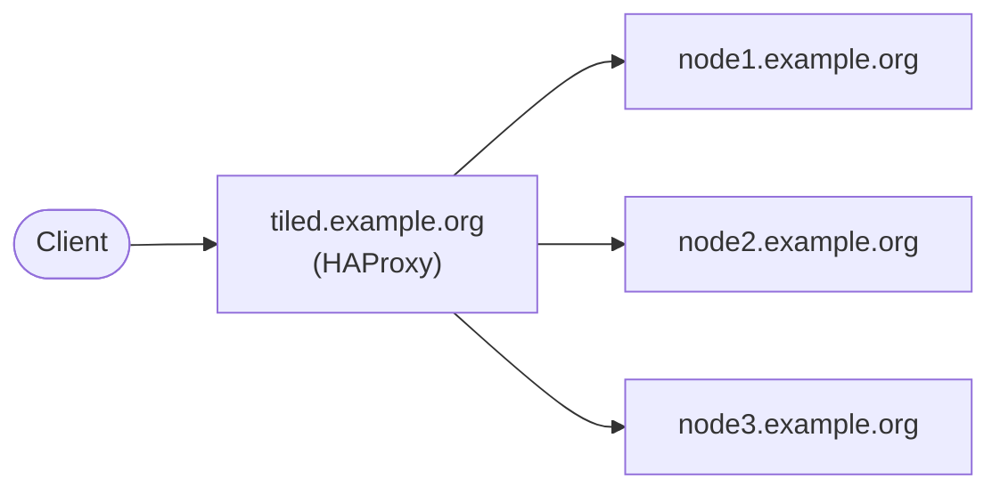
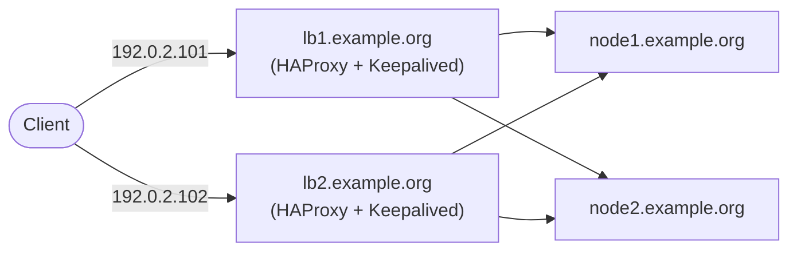

# Scale Tiled over Multiple Nodes

A Tiled server keeps its state in shared services (databases, Redis, and
storage), so a deployment can be scaled horizontally by running many Tiled
processes behind a load balancer. This gives
more capacity, keeps the service up when a node fails, and allows nodes to be
rebooted or upgraded one at a time without downtime.

This page shows one way to do this, using [HAProxy][] as the load balancer and
[Keepalived][] for a highly available pair of load balancers. Other load
balancers work on the same principles. For Kubernetes, see {doc}`helm`.

## What the nodes share

Every Tiled process must use the same configuration, and in particular the
same:

- catalog database (`catalog.uri`) and authentication database
  (`database.uri`)
- `authentication.secret_keys`, so that a token issued by one node is accepted
  by all the others
- Redis `streaming_cache`, so that streaming subscribers receive updates written
  through any node
- storage: files written to `writable_storage` must be readable at the same path
  on every node (for example, on a shared filesystem).

The databases and Redis can themselves be made highly available, as described
at the end of this page.

## Run several processes per node

A Tiled server process, like most Python web applications, effectively uses one
CPU core. To use a node's cores, run several processes, each on its own port:

```sh
tiled serve config config.yml --host 0.0.0.0 --port 5000
tiled serve config config.yml --host 0.0.0.0 --port 5001
# ...
```

## Load balancer



The load balancer terminates TLS and spreads requests across all the Tiled
processes. It polls each process's `/healthz` endpoint and stops sending
requests to any process that does not answer.

```text
global
    log /dev/log local0
    maxconn 4096

defaults
    mode http
    log global
    option httplog
    timeout connect 5s
    timeout client 60s
    timeout server 300s  # allow time for large reads and writes
    timeout tunnel 1h    # websockets (streaming)

resolvers dns
    parse-resolv-conf

frontend tiled
    bind *:80
    bind *:443 ssl crt /etc/haproxy/certs/tiled.example.org.pem alpn h2,http/1.1
    http-request redirect scheme https code 301 unless { ssl_fc }
    http-request set-header X-Forwarded-Proto https
    http-response set-header Strict-Transport-Security max-age=63072000
    default_backend tiled

backend tiled
    balance roundrobin
    option httpchk
    http-check send meth GET uri /healthz
    http-check expect status 200
    default-server check resolvers dns init-addr none resolve-opts allow-dup-ip
    server node1-5000 node1.example.org:5000
    server node1-5001 node1.example.org:5001
    server node2-5000 node2.example.org:5000
    server node2-5001 node2.example.org:5001
    # ... one line per Tiled process
```

Notes on this configuration:

- Each server line needs a unique name, so include the port in it.
- The `default-server` options make HAProxy look up the node hostnames at run
  time instead of at startup: `init-addr none` lets HAProxy start even when a
  hostname does not resolve yet, and `allow-dup-ip` permits several server lines
  with the same address (one per process). You can list more nodes than you
  have now; HAProxy starts sending them requests once they are in DNS and
  healthy, without a restart.
- Tiled uses `X-Forwarded-Proto` to build `https` links in its responses. Tiled
  only trusts this header from the addresses in `uvicorn.forwarded_allow_ips`
  (by default only `127.0.0.1`), so set this to your load balancers' addresses:

  ```yaml
  uvicorn:
    forwarded_allow_ips: "192.0.2.11,192.0.2.12"
  ```

  See {doc}`serve-behind-reverse-proxy` for details.

## Highly available load balancers

With a single load balancer, the whole service is down when the load balancer
is. To avoid this, run two load balancers, each with a virtual IP address (VIP)
managed by Keepalived. Each load balancer normally holds one VIP; if one of them
fails, the other takes over its VIP.



Publish both VIPs in DNS under the service name, so that clients spread their
requests across both load balancers:

```text
$ host tiled.example.org
tiled.example.org has address 192.0.2.101
tiled.example.org has address 192.0.2.102
```

Run the same HAProxy configuration on both load balancers. Keepalived on `lb1`
(address `192.0.2.11`):

```text
vrrp_track_process track_haproxy {
    process haproxy
    weight 20
}

vrrp_instance VIP1 {
    state MASTER
    interface eth0
    virtual_router_id 51
    priority 110
    unicast_src_ip 192.0.2.11
    unicast_peer {
        192.0.2.12
    }
    virtual_ipaddress {
        192.0.2.101/24
    }
    track_process {
        track_haproxy
    }
}

vrrp_instance VIP2 {
    state BACKUP
    interface eth0
    virtual_router_id 52
    priority 100
    unicast_src_ip 192.0.2.11
    unicast_peer {
        192.0.2.12
    }
    virtual_ipaddress {
        192.0.2.102/24
    }
    track_process {
        track_haproxy
    }
}
```

On `lb2` (address `192.0.2.12`), swap the two addresses in `unicast_src_ip` and
`unicast_peer`, and swap `state` and `priority` between the two instances, so
that `lb2` is the MASTER for `VIP2`.

Keepalived adds the `weight` to a node's priority while HAProxy is running on
it. If HAProxy stops, that node's priority drops below its peer's and the peer
takes over the VIP. For this to work, the weight must be larger than the
difference between the two priorities.

HAProxy's `bind *:443` accepts connections on whichever VIPs the node holds at
the moment. If you bind to the VIPs explicitly instead, set
`net.ipv4.ip_nonlocal_bind = 1` (in a file under `/etc/sysctl.d/`) so that
HAProxy can start while the other node holds a VIP.

For an introduction to Keepalived, see the
[Keepalived documentation](https://www.keepalived.org/documentation.html).

## Separate pools for reading and writing

You may want to keep data ingestion (for example, from data acquisition) from
competing with users reading data, by sending them to separate pools of nodes.
Add a second backend, `tiled-write`, configured like `tiled` above but listing
the nodes for writing, and choose between them in the frontend in one of these
ways.

**By hostname.** Point a second DNS name, such as `tiled-write.example.org`, at
the same load balancer (the TLS certificate must cover it too) and add to the
frontend:

```text
    use_backend tiled-write if { req.hdr(host) -i tiled-write.example.org }
```

**By request header.** Clients send a header to choose the write pool, which
lets them use one hostname for everything. NSLS-II uses this method:

```text
    use_backend tiled-write if { req.hdr(tiled-use) -m str MY_WRITE_PASSPHRASE }
```

```python
from tiled.client import from_uri

c = from_uri(
    "https://tiled.example.org",
    headers={"tiled-use": "MY_WRITE_PASSPHRASE"},
)
```

The header only selects the pool of nodes. It is not access control: Tiled
authenticates and authorizes every request in the same way, whichever pool
handles it.

## Redis high availability for streaming

Live data streaming (WebSocket subscriptions) is backed by a shared Redis
`streaming_cache`, so in a multi-node deployment every Tiled node must point at
the same Redis. To keep streaming available across a Redis outage, run Redis in
a high-availability topology (a primary with replicas fronted by Redis
Sentinel) and configure Tiled with `sentinels` and `service_name` instead of a
single `uri`; the client then follows Sentinel through a failover and resumes
subscriptions against the newly promoted primary.

Live streaming is **best-effort**: it is delivered over Redis Pub/Sub, which is
at-most-once, and the durable record is the SQL catalog, which is committed
before the streaming publish. An ordinary connection drop is
lossless — the client reconnects and resumes from the sequence number after the
last one it received, and the server replays anything it missed — so a normal
reconnect neither loses nor duplicates updates.

The residual risk is a Sentinel failover to a **replica that had not yet caught
up**. Redis replication is asynchronous and there is no per-write replication
confirmation, so two things can happen. First, any update the old primary
accepted but had not yet copied to that replica is gone — subscribers never
receive it. Second, the promoted replica's sequence counter is lower than the
old primary's, so as new updates arrive it hands out sequence numbers that were
already used, and subscribers receive those numbers a second time (now labeling
different data). Setting `min-replicas-to-write` / `min-replicas-max-lag` on the
Redis primary narrows this window but does not close it. See
{doc}`../reference/service-configuration` for the full `streaming_cache` field
reference.

## Postgres high availability

Tiled stores its data in Postgres. To keep Tiled writable across a database
node outage, run Postgres in a high-availability topology (a primary with
streaming replicas, managed by a tool such as [Patroni][] for automatic
failover) and give Tiled a **multi-host connection URI** listing every cluster
member, with `target_session_attrs=read-write` so the client connects to
whichever node is currently the read-write primary. The hosts are specified
using SQLAlchemy's
[multiple host connection string syntax][].

Tiled uses up to three PostgreSQL databases, and the same multi-host URI
applies to each: the **authentication** database (`database.uri`), the
**catalog** (`catalog.uri`), and Postgres **tabular storage** (a
`catalog.writable_storage` entry). Give each of them the multi-host URI:

```yaml
database:
  uri: "postgresql://tiled:${TILED_DATABASE_PASSWORD}@/tiled_authn?host=db1.example:5432&host=db2.example:5432&host=db3.example:5432&target_session_attrs=read-write&ssl=verify-full"

catalog:
  uri: "postgresql://tiled:${TILED_DATABASE_PASSWORD}@/tiled_catalog?host=db1.example:5432&host=db2.example:5432&host=db3.example:5432&target_session_attrs=read-write&ssl=verify-full"
  writable_storage:
    - "postgresql://tiled:${TILED_DATABASE_PASSWORD}@/tiled_storage?host=db1.example:5432&host=db2.example:5432&host=db3.example:5432&target_session_attrs=read-write&ssl=verify-full"
```

## Example: the NSLS-II deployment

These figures, from November 2026, may help with planning.

NSLS-II runs a single Postgres cluster (a primary and 3 replicas) for the whole
facility. It holds about 11 years of data from 30 beamlines; the facility
had 5 beamlines in 2015 and has about 33 now. At the time of writing, the
migration of this history into Tiled was about 80% complete.

| | Size on disk |
| --- | --- |
| Catalog | 390 GB, of which 158 GB is indexes (mostly the GIN index on metadata, which enables fast filtering on nested JSON) |
| Columnar (tabular) data | 1288 GB |

The service typically handles about 100 concurrent users and a few hundred
requests per second. The goal is for common searches to take less than 200 ms.
Some do already, but others take 1–10 s, and performance work is ongoing.
WebSocket streaming is used by only a few pilot projects so far.

So far a single Postgres cluster appears to scale. If it needs help, the plan
is to use Postgres [table partitioning][], for example by beamline (to spread a
heavy load) or by year (to keep recent data on faster disks), rather than run a
separate database per beamline. This is unrelated to Tiled's partitions of
columnar data.

The catalog is kept indefinitely. Columnar data stays in Postgres while an
experiment is running; afterwards it is to be moved to Parquet files, which
are cheaper to store, and archived later. The exact retention policy has not
been set.

[HAProxy]: https://www.haproxy.org/

[Keepalived]: https://www.keepalived.org/

[Patroni]: https://patroni.readthedocs.io/

[multiple host connection string syntax]: https://docs.sqlalchemy.org/en/20/dialects/postgresql.html#multihost-connections

[table partitioning]: https://www.postgresql.org/docs/current/ddl-partitioning.html
