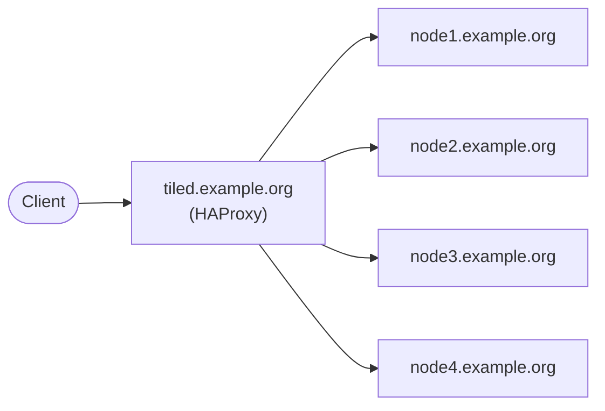
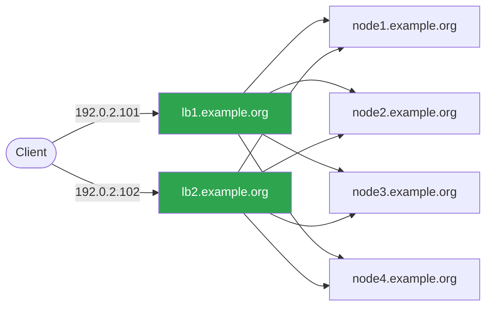
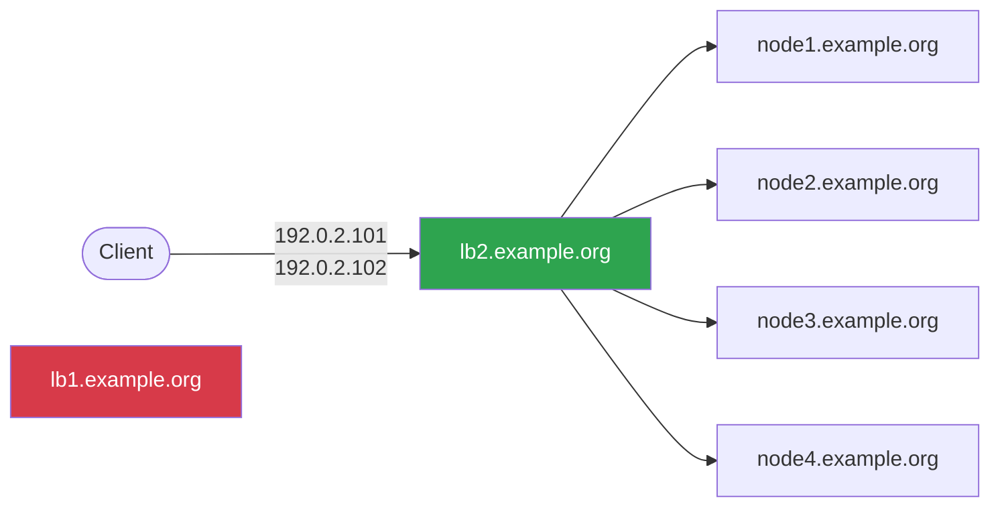

# Scale Tiled over Multiple Nodes

A Tiled server keeps its state in shared services (databases, Redis, and
storage), so a deployment can be scaled horizontally by running many Tiled
processes behind a load balancer. This gives more capacity, keeps the service
up when a node fails, and allows nodes to be rebooted or upgraded one at a time
without downtime.

This page shows one way to do this, using [HAProxy][] as the load balancer and
[Keepalived][] for a highly available pair of load balancers. Other load
balancers work on the same principles. For Kubernetes, see {doc}`helm`.

The first sections summarize the design. Complete, annotated configurations
follow in {ref}`multi-node-detailed-examples`.

## What the nodes share

Every Tiled process must use the same configuration, and in particular the
same:

- catalog database (`catalog.uri`) and authentication database
  (`database.uri`)
- `authentication.secret_keys`, so that a token issued by one node is accepted
  by all the others
- Redis `streaming_cache`, so that streaming subscribers receive updates written
  through any node
- storage: files written to `writable_storage` must be readable at the same path
  on every node (for example, on a shared filesystem).

The databases and Redis can themselves be made highly available, as described
below.

## Run several processes per node

A Tiled server process, like most Python web applications, effectively uses one
CPU core. To use a node's cores, run several processes, each on its own port:

```sh
tiled serve config config.yml --host 0.0.0.0 --port 5000
tiled serve config config.yml --host 0.0.0.0 --port 5001
# ...
```

(multi-node-load-balancer)=
## Load balancer



The load balancer terminates TLS and spreads requests across all the Tiled
processes. It polls each process's `/healthz` endpoint and stops sending
requests to any process that does not answer. HAProxy can look up the nodes in
DNS at run time, so nodes can be added without restarting it.

Tiled uses the `X-Forwarded-Proto` header, set by the load balancer, to build
`https` links in its responses. Tiled only trusts this header from the
addresses in `uvicorn.forwarded_allow_ips` (by default only `127.0.0.1`), so
set this to your load balancers' addresses:

```yaml
uvicorn:
  forwarded_allow_ips: "192.0.2.11,192.0.2.12"
```

See {doc}`serve-behind-reverse-proxy` for details, and
{ref}`multi-node-simple` and {ref}`multi-node-processes` for HAProxy
configurations.

## Highly available load balancers

With a single load balancer, the whole service is down when the load balancer
is. To avoid this, run two load balancers, each with a virtual IP address (VIP)
managed by Keepalived. Publish both VIPs in DNS under the service name, so that
clients spread their requests across both load balancers. Each load balancer
normally holds one VIP; if one of them fails, the other takes over its VIP. See
{ref}`multi-node-ha` for the configuration.

## Separate pools for reading and writing

You may want to keep data ingestion (for example, from data acquisition) from
competing with users reading data, by sending them to separate pools of nodes.
HAProxy can choose the pool in one of two ways:

- **By hostname**: clients that write use a second DNS name, such as
  `tiled-write.example.org`, that points at the same load balancer.
- **By request header**: clients that write send a header, which lets them use
  one hostname for everything. NSLS-II uses this method. In the Python client:

  ```python
  from tiled.client import from_uri

  c = from_uri(
      "https://tiled.example.org",
      headers={"tiled-qos": "acquisition"},
  )
  ```

The hostname or header only selects the pool of nodes. It is not access
control: Tiled authenticates and authorizes every request in the same way,
whichever pool handles it. See {ref}`multi-node-pools` for the configuration.

## Rate limiting

The load balancer can limit how many requests each client IP address makes, so
that one busy or misbehaving client cannot crowd out the others. It answers
requests over the limit with HTTP 429 and a `Retry-After` header, which the
Tiled Python client respects: it waits and retries (see {doc}`retries`). It can
also limit how many server errors (HTTP 500) each client triggers, to stop a
client that repeats a request that fails. See {ref}`multi-node-rate-limiting`
for the configuration and the limits NSLS-II uses.

## Redis high availability for streaming

Live data streaming (WebSocket subscriptions) is backed by a shared Redis
`streaming_cache`, so in a multi-node deployment every Tiled node must point at
the same Redis. To keep streaming available across a Redis outage, run Redis in
a high-availability topology (a primary with replicas fronted by Redis
Sentinel) and configure Tiled with `sentinels` and `service_name` instead of a
single `uri`; the client then follows Sentinel through a failover and resumes
subscriptions against the newly promoted primary.

Live streaming is **best-effort**: it is delivered over Redis Pub/Sub, which is
at-most-once, and the durable record is the SQL catalog, which is committed
before the streaming publish. An ordinary connection drop is
lossless — the client reconnects and resumes from the sequence number after the
last one it received, and the server replays anything it missed — so a normal
reconnect neither loses nor duplicates updates.

The residual risk is a Sentinel failover to a **replica that had not yet caught
up**. Redis replication is asynchronous and there is no per-write replication
confirmation, so two things can happen. First, any update the old primary
accepted but had not yet copied to that replica is gone — subscribers never
receive it. Second, the promoted replica's sequence counter is lower than the
old primary's, so as new updates arrive it hands out sequence numbers that were
already used, and subscribers receive those numbers a second time (now labeling
different data). Setting `min-replicas-to-write` / `min-replicas-max-lag` on the
Redis primary narrows this window but does not close it. See
{doc}`../reference/service-configuration` for the full `streaming_cache` field
reference.

## Postgres high availability

Tiled stores its data in Postgres. To keep Tiled writable across a database
node outage, run Postgres in a high-availability topology (a primary with
streaming replicas, managed by a tool such as [Patroni][] for automatic
failover) and give Tiled a **multi-host connection URI** listing every cluster
member, with `target_session_attrs=read-write` so the client connects to
whichever node is currently the read-write primary. The hosts are specified
using SQLAlchemy's
[multiple host connection string syntax][].

Tiled uses up to three PostgreSQL databases, and the same multi-host URI
applies to each: the **authentication** database (`database.uri`), the
**catalog** (`catalog.uri`), and Postgres **tabular storage** (a
`catalog.writable_storage` entry). Give each of them the multi-host URI:

```yaml
database:
  uri: "postgresql://tiled:${TILED_DATABASE_PASSWORD}@/tiled_authn?host=db1.example:5432&host=db2.example:5432&host=db3.example:5432&target_session_attrs=read-write&ssl=verify-full"

catalog:
  uri: "postgresql://tiled:${TILED_DATABASE_PASSWORD}@/tiled_catalog?host=db1.example:5432&host=db2.example:5432&host=db3.example:5432&target_session_attrs=read-write&ssl=verify-full"
  writable_storage:
    - "postgresql://tiled:${TILED_DATABASE_PASSWORD}@/tiled_storage?host=db1.example:5432&host=db2.example:5432&host=db3.example:5432&target_session_attrs=read-write&ssl=verify-full"
```

## Example: the NSLS-II deployment

These figures, from November 2026, may help with planning.

NSLS-II runs a single Postgres cluster (a primary and 3 replicas) for the whole
facility. It holds about 11 years of data from 30 beamlines; the facility
had 5 beamlines in 2015 and has about 33 now. At the time of writing, the
migration of this history into Tiled was about 80% complete.

| | Size on disk |
| --- | --- |
| Catalog | 390 GB, of which 158 GB is indexes (mostly the GIN index on metadata, which enables fast filtering on nested JSON) |
| Columnar (tabular) data | 1288 GB |

The service typically handles about 100 concurrent users and a few hundred
requests per second. The goal is for common searches to take less than 200 ms.
Some do already, but others take 1–10 s, and performance work is ongoing.
WebSocket streaming is used by only a few pilot projects so far.

So far a single Postgres cluster appears to scale. If it needs help, the plan
is to use Postgres [table partitioning][], for example by beamline (to spread a
heavy load) or by year (to keep recent data on faster disks), rather than run a
separate database per beamline. This is unrelated to Tiled's partitions of
columnar data.

The catalog is kept indefinitely. Columnar data stays in Postgres while an
experiment is running; afterwards it is to be moved to Parquet files, which
are cheaper to store, and archived later. The exact retention policy has not
been set.

(multi-node-detailed-examples)=
## Detailed examples

The examples below use the hostnames `node1.example.org` to
`node4.example.org` for the Tiled nodes and `tiled.example.org` for the
service, with Tiled listening on port 5000.

(multi-node-simple)=
### A simple multi-node deployment

A single HAProxy load balancer receives all requests to `tiled.example.org`
and distributes them across the Tiled nodes, as in the diagram under
{ref}`multi-node-load-balancer` above.

```text
global
    log /dev/log local0
    maxconn 2048
    daemon

defaults
    mode http
    log global
    timeout connect 5s
    timeout client 60s
    timeout server 300s  # allow time for large reads and writes
    timeout tunnel 1h    # websockets (streaming)

frontend tiled_frontend
    bind *:80
    bind *:443 ssl crt /etc/haproxy/certs/tiled.example.org.pem alpn h2,http/1.1
    default_backend tiled_backend
    option httplog

    # Redirect HTTP to HTTPS.
    http-request redirect scheme https code 301 unless { ssl_fc }

    # Make Tiled build https links in its responses.
    http-request set-header X-Forwarded-Proto https if { ssl_fc }

    # HSTS (63072000 seconds)
    http-response set-header Strict-Transport-Security max-age=63072000

backend tiled_backend
    balance roundrobin

    # Send requests only to nodes that pass the health check.
    option httpchk
    http-check connect
    http-check send meth GET uri /healthz ver HTTP/1.1 hdr Host tiled.example.org
    http-check expect status 200

    server node1 node1.example.org:5000 check
    server node2 node2.example.org:5000 check
    server node3 node3.example.org:5000 check
    server node4 node4.example.org:5000 check
```

The load balancer listens on HTTP (port 80) and HTTPS (port 443) and redirects
HTTP to HTTPS. Requests are distributed round-robin to the nodes that pass the
health check, so if one or more nodes go down, the others keep serving.

The `timeout tunnel` applies to WebSocket connections, which the streaming API
uses. They are long-lived, so they need a longer timeout than ordinary
requests.

(multi-node-processes)=
### Several processes per node

If each node runs 4 Tiled processes, on ports 5000 to 5003, the backend has 16
server lines. Replace the `backend` section above with this one, and add a
`resolvers` section:

```text
resolvers default_dns
    # DNS servers for HAProxy to use to resolve backend hostnames at run time.
    nameserver dns1 192.0.2.53:53
    nameserver dns2 192.0.2.54:53
    accepted_payload_size 512

    # If a valid response was received within this period, ignore a newer
    # invalid one.
    hold valid    180s
    hold other    180s
    hold refused  180s
    hold nx       180s
    hold timeout  180s
    hold obsolete 180s

backend tiled_backend
    balance roundrobin

    option httpchk
    http-check connect
    http-check send meth GET uri /healthz ver HTTP/1.1 hdr Host tiled.example.org
    http-check expect status 200

    default-server check resolvers default_dns init-addr none resolve-opts allow-dup-ip
    server node1-5000 node1.example.org:5000
    server node1-5001 node1.example.org:5001
    server node1-5002 node1.example.org:5002
    server node1-5003 node1.example.org:5003
    server node2-5000 node2.example.org:5000
    server node2-5001 node2.example.org:5001
    server node2-5002 node2.example.org:5002
    server node2-5003 node2.example.org:5003
    server node3-5000 node3.example.org:5000
    server node3-5001 node3.example.org:5001
    server node3-5002 node3.example.org:5002
    server node3-5003 node3.example.org:5003
    server node4-5000 node4.example.org:5000
    server node4-5001 node4.example.org:5001
    server node4-5002 node4.example.org:5002
    server node4-5003 node4.example.org:5003
```

Each server line needs a unique name, so the names include the port. The
`default-server` line applies these options to every server:

- `resolvers default_dns`: resolve the hostnames at run time with the DNS
  servers in the `resolvers` section. (Instead of listing `nameserver`s, the
  `resolvers` section can contain `parse-resolv-conf` to use the servers in
  `/etc/resolv.conf`.)
- `init-addr none`: do not resolve the hostnames at startup, so that HAProxy
  starts even if some nodes are not available yet.
- `resolve-opts allow-dup-ip`: allow several servers with the same IP address.
  By default HAProxy disables a server that resolves to the same address as
  another one in the backend, and here every node has 4 servers.

Because HAProxy resolves hostnames at run time, it follows changes without a
restart, for example when a node's IP address changes.

```{tip}
With these options, you can list more nodes in the configuration than you have
now. When a new node is added to DNS and Tiled starts on it, HAProxy starts
sending requests to it without any change to its configuration and without a
restart.
```

(multi-node-ha)=
### Highly available load balancers

The examples above do not make the load balancer itself highly available. If
it goes down, the whole service is unavailable, even if all the Tiled nodes are
healthy. To avoid this, run two HAProxy load balancers, `lb1.example.org`
(`192.0.2.11`) and `lb2.example.org` (`192.0.2.12`), with the same HAProxy
configuration, and use Keepalived to share two virtual IP addresses (VIPs),
`192.0.2.101` and `192.0.2.102`, between them. Both load balancers are active
(an *active-active* configuration).

To spread requests across both load balancers, DNS resolves the service name
to both VIPs, and clients choose between them by DNS round robin:

```text
$ host tiled.example.org
tiled.example.org has address 192.0.2.101
tiled.example.org has address 192.0.2.102
```

Normally each load balancer holds one VIP:



If one load balancer fails, the other takes over its VIP, and serves requests
to both VIPs:



```{note}
For an introduction to Keepalived, see this
[introduction from Red Hat](https://www.redhat.com/en/blog/keepalived-basics)
and the [Keepalived documentation](https://www.keepalived.org/documentation.html).
```

The Keepalived configuration on `lb1.example.org`:

```text
global_defs {
    router_id lb1
    enable_script_security
    script_user keepalived_script
}

vrrp_track_process chk_haproxy {
    process "haproxy"
    weight 10
}

vrrp_instance 50 {
    state MASTER
    interface ens192
    virtual_router_id 50
    priority 110
    advert_int 1

    virtual_ipaddress {
        192.0.2.101/24
    }

    unicast_src_ip 192.0.2.11
    unicast_peer {
        192.0.2.12
    }

    track_process {
        chk_haproxy
    }
}

vrrp_instance 51 {
    state BACKUP
    interface ens192
    virtual_router_id 51
    priority 109
    advert_int 1

    virtual_ipaddress {
        192.0.2.102/24
    }

    unicast_src_ip 192.0.2.11
    unicast_peer {
        192.0.2.12
    }

    track_process {
        chk_haproxy
    }
}
```

The Keepalived configuration on `lb2.example.org`:

```text
global_defs {
    router_id lb2
    enable_script_security
    script_user keepalived_script
}

vrrp_track_process chk_haproxy {
    process "haproxy"
    weight 10
}

vrrp_instance 50 {
    state BACKUP
    interface ens192
    virtual_router_id 50
    priority 109
    advert_int 1

    virtual_ipaddress {
        192.0.2.101/24
    }

    unicast_src_ip 192.0.2.12
    unicast_peer {
        192.0.2.11
    }

    track_process {
        chk_haproxy
    }
}

vrrp_instance 51 {
    state MASTER
    interface ens192
    virtual_router_id 51
    priority 110
    advert_int 1

    virtual_ipaddress {
        192.0.2.102/24
    }

    unicast_src_ip 192.0.2.12
    unicast_peer {
        192.0.2.11
    }

    track_process {
        chk_haproxy
    }
}
```

Each load balancer is the MASTER for one VIP and the BACKUP for the other.
`unicast_src_ip` is always the node's own address and `unicast_peer` the other
node's. Keepalived adds the `weight` to the node's priority while HAProxy is
running on it. If HAProxy stops, the node's priority drops below its peer's
(here from 120 to 110, against 119), and the peer takes over the VIP. For this
to work, the weight must be larger than the difference between the priorities.

HAProxy's `bind *:80` and `bind *:443` accept connections on whichever VIPs the
node holds at the moment. To bind HAProxy to the VIPs only, add the
`transparent` option, which lets HAProxy bind to an address that the node does
not hold when HAProxy starts. On `lb1.example.org`:

```text
frontend tiled_frontend
    bind 192.0.2.101:80 transparent
    bind 192.0.2.101:443 transparent ssl crt /etc/haproxy/certs/tiled.example.org.pem alpn h2,http/1.1
```

and on `lb2.example.org`:

```text
frontend tiled_frontend
    bind 192.0.2.102:80 transparent
    bind 192.0.2.102:443 transparent ssl crt /etc/haproxy/certs/tiled.example.org.pem alpn h2,http/1.1
```

Instead of `transparent`, you can allow all processes to bind to addresses that
the node does not hold, by setting this in a file under `/etc/sysctl.d/`:

```text
net.ipv4.ip_nonlocal_bind = 1
```

(multi-node-pools)=
### Separate pools for reading and writing

In these examples, nodes 1–4 serve reading and nodes 5–8 serve writing. Both
methods below use two backends, `tiled_read_backend` and `tiled_write_backend`.
Each is configured like `tiled_backend` above, with its own list of servers:

```text
backend tiled_read_backend
    balance roundrobin

    option httpchk
    http-check connect
    http-check send meth GET uri /healthz ver HTTP/1.1 hdr Host tiled.example.org
    http-check expect status 200

    default-server check resolvers default_dns init-addr none resolve-opts allow-dup-ip
    server node1 node1.example.org:5000
    server node2 node2.example.org:5000
    server node3 node3.example.org:5000
    server node4 node4.example.org:5000

backend tiled_write_backend
    balance roundrobin

    option httpchk
    http-check connect
    http-check send meth GET uri /healthz ver HTTP/1.1 hdr Host tiled.example.org
    http-check expect status 200

    default-server check resolvers default_dns init-addr none resolve-opts allow-dup-ip
    server node5 node5.example.org:5000
    server node6 node6.example.org:5000
    server node7 node7.example.org:5000
    server node8 node8.example.org:5000
```

**By hostname.** Clients use `write.tiled.example.org` to write and
`read.tiled.example.org` to read, and the frontend chooses the backend from the
`Host` header of the request:

```text
frontend tiled_frontend
    # ... as above ...
    default_backend tiled_read_backend

    acl is_write hdr(host) -i write.tiled.example.org
    use_backend tiled_write_backend if is_write

    acl is_read hdr(host) -i read.tiled.example.org
    use_backend tiled_read_backend if is_read
```

The TLS certificate must cover both names. Both names resolve to the load
balancer's address (or VIPs), with A records:

```text
$ host write.tiled.example.org
write.tiled.example.org has address 192.0.2.101

$ host read.tiled.example.org
read.tiled.example.org has address 192.0.2.101
```

or with CNAME records:

```text
$ host tiled.example.org
tiled.example.org has address 192.0.2.101

$ host write.tiled.example.org
write.tiled.example.org is an alias for tiled.example.org.

$ host read.tiled.example.org
read.tiled.example.org is an alias for tiled.example.org.
```

**By request header.** NSLS-II uses this method, to send data written by
beamline data acquisition to the write pool and requests from users to the read
pool. All clients use one hostname, `tiled.example.org`, and clients that write
add the header `tiled-qos: acquisition`. A client can then choose the
pool for each request, using a single pool of HTTP connections.

```text
frontend tiled_frontend
    # ... as above ...
    default_backend tiled_read_backend

    acl is_write req.hdr(tiled-qos) -m str acquisition
    use_backend tiled_write_backend if is_write
```

For example, with `curl`, this request goes to the write pool:

```text
curl -H "tiled-qos: acquisition" https://tiled.example.org/api/v1/
```

and a request without the header, or with a different value, goes to the read
pool:

```text
curl https://tiled.example.org/api/v1/
```

(multi-node-rate-limiting)=
### Rate limiting

HAProxy counts requests per client IP address in *stick tables*. This example
builds on the request-header configuration above and sets the limits NSLS-II
uses:

| Pool | Requests per client IP | HTTP 500 responses per client IP |
| --- | --- | --- |
| Read | 1000 per 10 seconds | 200 per 60 seconds |
| Write (data acquisition) | 2000 per 10 seconds | counted, not limited |

For scale, in 26 hours of NSLS-II traffic the busiest client of the read pool
peaked at about 2250 requests per 10 seconds, during one 15-minute burst; the
next busiest peaked at 168. The busiest client of the write pool peaked at 42.

```text
# One table for request rates and one for error rates, per pool.
# Entries are keyed by client IP address and expire after 30 minutes idle.
backend st_read_requests
    stick-table type ipv6 size 10m expire 30m store http_req_rate(10s)

backend st_write_requests
    stick-table type ipv6 size 10m expire 30m store http_req_rate(10s)

backend st_read_errors
    stick-table type ipv6 size 10m expire 30m store gpc0,gpc0_rate(60s)

backend st_write_errors
    stick-table type ipv6 size 10m expire 30m store gpc0,gpc0_rate(60s)

frontend tiled_frontend
    # ... as above ...
    default_backend tiled_read_backend

    acl is_write req.hdr(tiled-qos) -m str acquisition
    use_backend tiled_write_backend if is_write

    # Do not limit an address shared by many unrelated clients, such as a
    # NAT gateway, or one client could use up the others' allowance.
    acl rate_limit_bypass src 192.0.2.250

    # Count requests (sc1) and errors (sc2) per client IP, in the pool's tables.
    http-request track-sc1 src table st_write_requests if is_write !rate_limit_bypass
    http-request track-sc1 src table st_read_requests if !is_write !rate_limit_bypass
    http-request track-sc2 src table st_write_errors if is_write !rate_limit_bypass
    http-request track-sc2 src table st_read_errors if !is_write !rate_limit_bypass
    http-after-response sc-inc-gpc0(2) if { status 500 }

    # Over the request limit: answer 429 and ask the client to retry in 10 s.
    http-request return status 429 content-type text/plain hdr retry-after 10 string "Too Many Requests\n" if is_write { sc_http_req_rate(1) gt 2000 }
    http-request return status 429 content-type text/plain hdr retry-after 10 string "Too Many Requests\n" if !is_write { sc_http_req_rate(1) gt 1000 }

    # Over the error limit (read pool only): ask the client to retry in 60 s.
    http-request return status 429 content-type text/plain hdr retry-after 60 string "Too Many Requests\n" if !is_write { sc_gpc0_rate(2) gt 200 }
```

`sc_http_req_rate(1)` is the client's request count over the last 10 seconds,
including the current request, and `sc_gpc0_rate(2)` its count of HTTP 500
responses over the last 60 seconds. The tracking rules must come before the
rules that use them.

To choose limits, start in a report-only mode: mark requests over the limit
instead of refusing them, and watch which clients would be refused. NSLS-II
runs its production service this way; only its staging service refuses
requests over the read pool's request limit. Replace each `http-request return` rule with a rule that sets a
variable, and add the variable to the response:

```text
    http-request set-var(txn.rate_limit_action) str(request) if !is_write { sc_http_req_rate(1) gt 1000 }
    http-request set-var(txn.rate_limit_action) str(error) if !is_write { sc_gpc0_rate(2) gt 200 }
    http-after-response set-header rate-limit-would-deny %[var(txn.rate_limit_action)] if { var(txn.rate_limit_action) -m found }
```

To log each client's rates, store them in variables and add these to your
`log-format`, for example as `rl_req=%[var(txn.rl_req)] rl_err=%[var(txn.rl_err)]`:

```text
    http-request set-var(txn.rl_req) sc_http_req_rate(1)
    http-request set-var(txn.rl_err) sc_gpc0_rate(2)
```

```{note}
Each load balancer counts only the requests it receives. With two active load
balancers (see {ref}`multi-node-ha`), DNS round robin splits a client's requests
between them, so each one sees about half. NSLS-II uses the Global Profiling
Engine of HAProxy Enterprise to add up the counts from both load balancers and
apply the limits to the total. The open source HAProxy can copy stick-table
entries between load balancers with a `peers` section, but it does not add
them up; there, you could set each load balancer's limits to half of the
intended total instead.
```

[HAProxy]: https://www.haproxy.org/

[Keepalived]: https://www.keepalived.org/

[Patroni]: https://patroni.readthedocs.io/

[multiple host connection string syntax]: https://docs.sqlalchemy.org/en/20/dialects/postgresql.html#multihost-connections

[table partitioning]: https://www.postgresql.org/docs/current/ddl-partitioning.html
